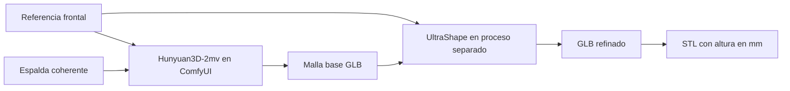

# Forma · Imagen a STL

Aplicación local para transformar imágenes en modelos 3D con ComfyUI y Hunyuan3D,
refinar su geometría con UltraShape y exportar STL a una medida explícita.
Incluye visor, historial, progreso por etapas y controles para detener y regenerar.
El flujo vigente funciona sin Blender.

Probado en **NVIDIA RTX 3050 de 8 GB**, **64 GB de RAM** y Windows, utilizando
RAM y GPU conjuntamente mediante descarga de bloques. El usuario aceptó
visualmente la figura con referencias preparadas por IA. El lobito poligonal
terminó también; su aceptación visual sigue pendiente.


## Empezar en otra PC

1. Instalar Git, Python **3.11 de 64 bits**, Node.js **22.12 o superior de la rama
   22**, 7-Zip y un controlador NVIDIA compatible con las versiones CUDA usadas.
2. Clonar y preparar la aplicación:

   ```powershell
   git clone https://github.com/pvaldivia1994/v_img_to_stl.git C:\_Github\v_img_to_stl
   Set-Location C:\_Github\v_img_to_stl
   py -3.11 -m venv .venv
   .venv\Scripts\python.exe -m pip install -r requirements.lock.txt
   Push-Location frontend
   npm.cmd ci
   npm.cmd run build
   Pop-Location
   ```

3. Seguir la [instalación completa](docs/INSTALLATION.md): descargar ComfyUI
   portable, los checkpoints y el nodo propio. UltraShape tiene un entorno
   separado y una prueba inicial. **Clonar el repositorio no descarga los modelos
   ni instala automáticamente ComfyUI.**
4. Abrir `Iniciar.cmd` y entrar en [la aplicación local](http://127.0.0.1:8000/).

Las rutas actuales de motores y modelos usan `C:\_IA`. La guía identifica las
rutas a cambiar si se usa otra unidad. Otros sistemas operativos no están validados.

## El flujo que dio buen resultado



Las referencias IA de los ejemplos se hicieron con el **generador de imágenes
integrado de ChatGPT**, fuera de ComfyUI. Este editor no se instala en la PC ni
forma parte del backend. También se pueden usar imágenes propias. La skill
explica cómo construir referencias coherentes. Los prompts de preparación no
condicionan directamente la geometría del flujo Hunyuan aquí implementado.

## Uso

- Cargar el frente. Para añadir espalda, activar **Usar varias vistas** y elegir
  Hunyuan3D 2.0; se selecciona automáticamente el checkpoint multivista.
- Usar una vista por archivo, fondo limpio y figura completa. Desactivar
  **Preparar fondo blanco** si las referencias ya están preparadas.
- Generar y revisar el visor. El porcentaje pertenece a la **etapa actual**.
- **Detener** cancela el cálculo y lo pendiente de su comparación. **Regenerar**
  conserva imágenes, semilla y parámetros en un intento nuevo.
- Exportar a una altura explícita. Conservar solo la pieza principal es opcional:
  puede retirar componentes pequeños intencionales. El original permanece intacto.

El botón **Refinar detalles con UltraShape** conserva los valores exploratorios
actuales de `app/refinement.py`: 75 pasos, 16384 latentes y extracción 768.
Para repetir el flujo aceptado, usar este ejecutor desde la raíz:

```powershell
.venv\Scripts\python.exe -u -m scripts.run_hybrid_fidelity --reference-directory assets\references\approved-fox --name "Mi figura"
```

Crea **una malla multivista y después un refinamiento**, en secuencia. No lanzarlo
mientras haya otra generación. Toma `config/approved-generation.json`, o la
referencia aprobada local de `data/approved-reference.json` si existe.
El preset aceptado usa Hunyuan-2mv con 50 pasos, semilla 4007959359 y extracción
512; después UltraShape con 50 pasos, 32768 latentes, CFG secuencial,
extracción 512 y semilla 42.

## Modelos y requisitos

| Componente | Uso | Archivo principal |
|---|---|---:|
| Hunyuan3D 2.0 | Una imagen | 4,93 GB |
| Hunyuan3D-2mv | Varias vistas; flujo aceptado | 4,93 GB |
| Hunyuan3D 2.1 | Comparación experimental; solo frente | 7,37 GB |
| UltraShape v1 | Refinamiento de imagen y malla | 7,37 GB |
| U2Net | Fondo opcional en CPU | ~176 MB |

Las [descargas y mediciones](docs/MODELS_AND_HARDWARE.md) incluyen URLs, hashes,
versiones y límites. Pesos, motores, entornos y resultados pesados **no están
en Git**. Presupuestar entre 60 y 100 GB libres para instalación completa,
cachés y primeras pruebas; es una estimación, no un mínimo medido.

## Documentación

| Documento | Contenido |
|---|---|
| [AGENTS.md](AGENTS.md) | Arquitectura, invariantes y decisiones para agentes |
| [Skill local](.agents/skills/prepare-3d-references/SKILL.md) | Cómo generar y revisar las imágenes |
| [Instalación](docs/INSTALLATION.md) | Reconstruir los tres entornos en otra PC |
| [Modelos y hardware](docs/MODELS_AND_HARDWARE.md) | Descargas, hashes y resultados |
| [Historia y estado](docs/PROJECT_HISTORY.md) | Qué se probó, qué funcionó y pendientes |
| [Controles](docs/GENERATION_CONTROLS.md) | Cancelación real y regeneración |
| [Referencia aceptada](docs/APPROVED_REFERENCE.md) | Aceptación visual y parámetros |
| [Prompts aceptados](docs/IMAGE_PREPARATION_PROMPTS.md) | Preparación IA de la primera figura |
| [Lobito poligonal](docs/POLYGONAL_WOLF_PROMPTS.md) | Prompts y corrección de la cola |
| [Respaldo](docs/BACKUP_AND_PUBLICATION.md) | Qué se publica y cómo migrar resultados |
| [Terceros](docs/THIRD_PARTY.md) | Procedencia y licencias de componentes |
| [PLAN.md](PLAN.md) | Registro de tareas de la sesión original |

## Verificación

```powershell
.venv\Scripts\python.exe -m pip install -r requirements-dev.txt
.venv\Scripts\python.exe -m pytest -q
Push-Location frontend
npm.cmd ci
npm.cmd run build
Pop-Location
```

Las pruebas de aplicación no requieren pesos, ComfyUI ni GPU; no demuestran
calidad artística. Las comprobaciones con PyTorch se ejecutan aparte en el
entorno UltraShape, como explica la instalación.

## Red y almacenamiento

La web escucha en `0.0.0.0:8000`; ComfyUI en `127.0.0.1:8188`. Para compartirla
en la subred, ejecutar `Habilitar-red.cmd` como administrador y usar
`http://IP-DE-ESTA-PC:8000`. No hay autenticación: los dispositivos permitidos
pueden consultar y operar los proyectos. El script no abre ComfyUI ni configura
acceso desde Internet. Las IP históricas de los informes no son portátiles.

Los proyectos y logs se guardan en `data/`. Cerrar la pestaña no detiene un cálculo.
`Detener.cmd` cierra los servicios: usar primero **Detener** en la web si hay
trabajos activos, pues los refinadores independientes pueden sobrevivir al
cierre de la aplicación.

Una malla cerrada no garantiza espesores ni impresión correcta. Los STL no
conservan colores. Revisar capas y espesores en el laminador; no se requiere Blender.
